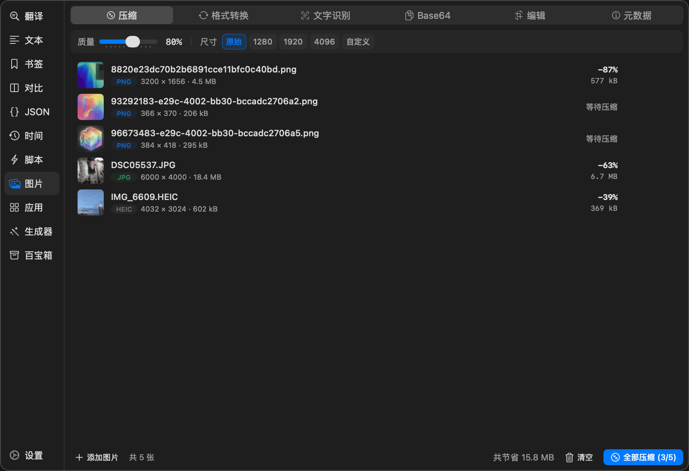
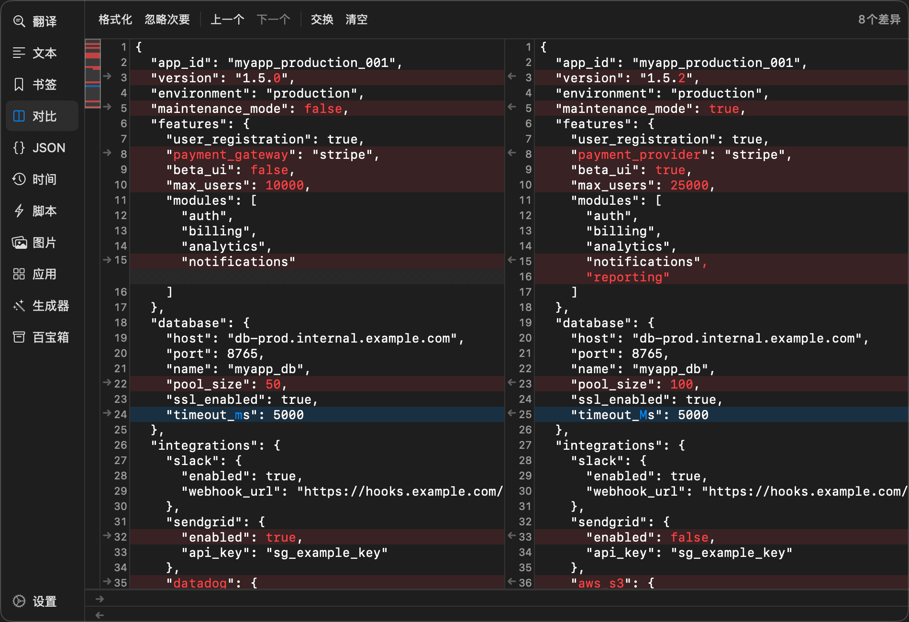
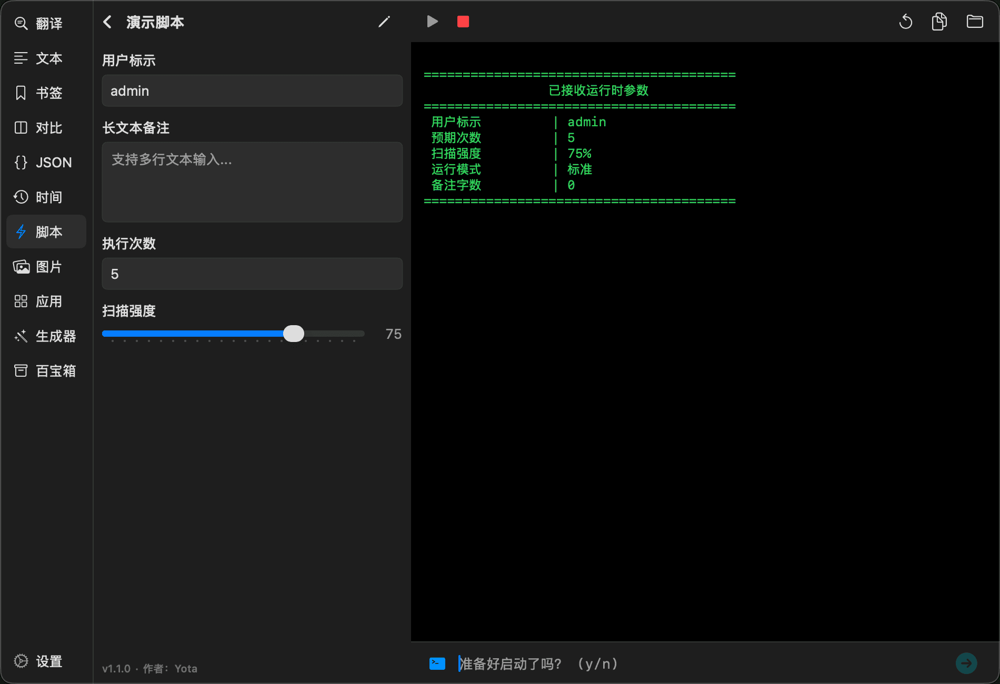
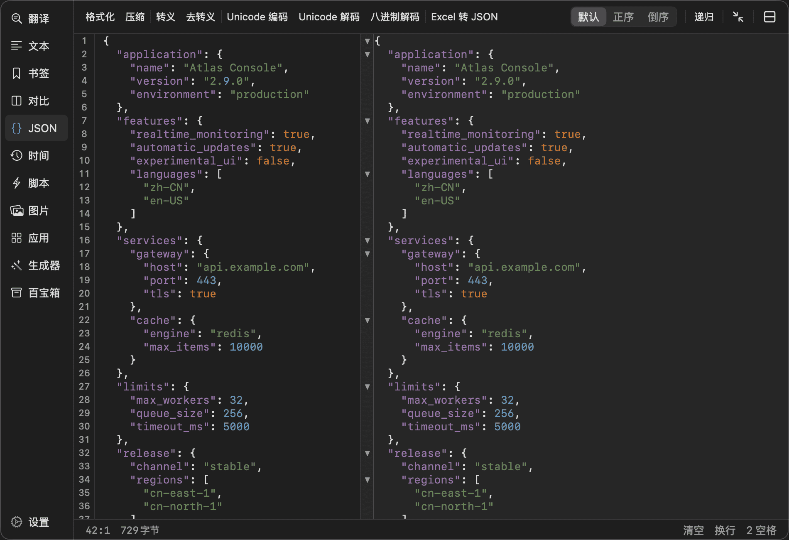
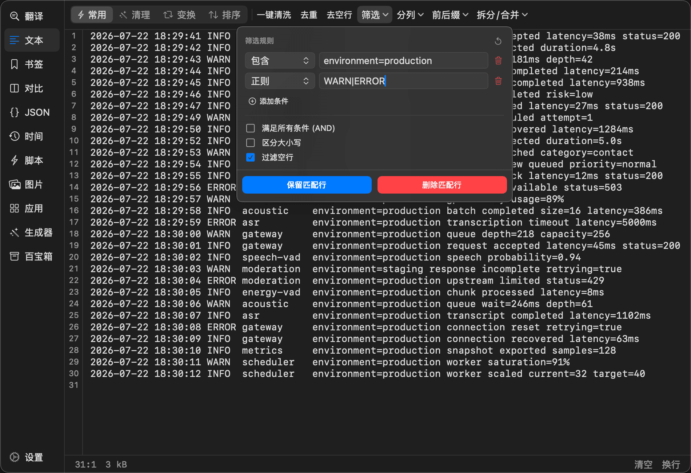

<div align="center">
  

  <h1>Yota</h1>

  <p><strong>Copy to recognize. Turn scripts into tools.</strong></p>

  <p>A native menu bar productivity utility for clipboard recognition and cross-app workflows, with fast processing for text, JSON, images, and time data.</p>

  <p>
    
    <a href="https://github.com/chengu61/Yota/releases/latest">
      
    </a>
  </p>

  <p><a href="./README.md">简体中文</a> &nbsp;|&nbsp; <strong>English</strong></p>

  <p>
    <a href="https://github.com/chengu61/Yota/releases/latest">Download</a>
    &nbsp;&middot;&nbsp;
    <a href="#installation">Installation</a>
    &nbsp;&middot;&nbsp;
    <a href="./CHANGELOG.md">Changelog</a>
  </p>
</div>

<div align="center">
  <a href="./docs/image.png">
    
  </a>
</div>

## How It Works

Press `Shift + Space` by default, or click the menu bar icon, to open Yota. The interface is available in Simplified Chinese and English, and you can switch languages instantly in Settings. You can also change the shortcut, reorder or hide tools, and switch between workspaces without losing their content or state.

## Clipboard and Cross-App Workflows

Yota can recognize clipboard content in the background. Its matching rules are deliberately strict to prevent ordinary numbers, order IDs, and code fragments from opening tools unexpectedly.

- Copy a Unix timestamp, ISO 8601 value, log date, or Chinese date to see the converted result in a corner of the screen.
- Copy an object, array, or JSON embedded in mixed text to open it in the JSON tool automatically.
- Open an empty Compare workspace and copy two pieces of text in succession: the first goes to the left, and the second goes to the right and starts the comparison.
- Repeated copies of identical content can be ignored. Background recognition pauses while you are interacting with Yota.
- Time, JSON, and Compare monitoring can each be disabled. Hiding a tool also disables its corresponding monitor.

## Bookmarks

Bookmarks can split content by line or paragraph. Click a bookmark once, then press `Cmd + V` repeatedly in a browser, terminal, or another app. Yota prepares the next segment after each paste.

- Four click actions: copy all, copy line by line, copy paragraph by paragraph, or edit.
- Separate content from notes with a blank line. Notes are excluded from the sequential paste queue.
- Reference another bookmark with <code>&#123;&#123;Bookmark Title&#125;&#125;</code>, with circular-reference detection.
- Renaming a bookmark updates references to it in other bookmarks.
- Grid and list views, multiple tags, tag autocomplete, Pinyin search, and drag-and-drop ordering.
- Usage statistics, undo after deletion, unsaved-change warnings, and JSON import and export.
- Private content is blurred by default; `Cmd + Click` reveals it temporarily.

Automatic clipboard advancement requires Accessibility permission. Without permission, every segment can still be copied manually.

## Image

- **Compression**: Batch-process PNG, JPEG, WebP, and HEIC images with quality, maximum-dimension, and concurrency controls, compression statistics, and before-and-after previews. The original is kept when compression would produce a larger file.
- **Format Conversion**: Batch-convert between PNG, JPEG, WebP, HEIC, and other formats, with quality controls, previews, and batch export.
- **OCR**: Use macOS Vision to recognize Simplified Chinese, Traditional Chinese, and English locally, with image scaling, contrast preprocessing, segmented results, and full-text copy.
- **Base64**: Convert images to and from Base64, with optional Data URI prefixes, live preview, and restored-image export.
- **Editing**: Subject extraction, mask erase and restore, crop, rotate, flip, canvas zoom, brush, shapes, arrows, blur, and pixelation, with undo and redo.
- **Metadata**: Inspect dimensions, color space, camera, exposure, GPS, and other EXIF data, then remove metadata from one or multiple images before saving copies.

## Compare

- Myers diff and anchor-based divide-and-conquer algorithms optimized for large text, with differences computed in the background.
- Physically aligned line heights and synchronized scrolling between the two panes.
- Line-, word-, and character-level differences shown together.
- A diff minimap shows the overall distribution and supports click-and-drag navigation.
- Search, difference counts, previous/next difference navigation, and swapping the two inputs.
- Apply a contiguous diff block to the opposite side by clicking its arrow.
- Mark whitespace, line-break, and case-only changes as minor differences and ignore them when needed.
- Drop text files directly into either pane. When both sides contain JSON, format and sort by key before comparing.

<div align="center">
  <a href="./docs/compare.png">
    
  </a>
</div>

## Scripts

Add folders containing Python, Node.js, Shell, or Ruby scripts as script libraries. Yota discovers scripts automatically and refreshes the list when a folder changes.

Scripts can declare parameters in YAML comments at the top of the file, and Yota builds a native form from those declarations. Supported features include:

- Eight control types: text, multiline text, number, slider, toggle, select, file, and directory.
- Required-field validation, numeric bounds, step values, secure text, and conditional `show_if` parameters.
- Automatic discovery of Python `.venv` and `venv` environments, plus other interpreters available in the system environment.
- Multiple script libraries, categories, favorites, Pinyin search, and preserved run state.
- Script creation, syntax-highlighted editing, search, save-and-run, and unsaved-change warnings.
- Live stdout and stderr, process termination, log copying, and interactive stdin.
- JSON instructions written to stdout can request user input, copy a result, or open a URL.

See the in-app Script Development Guide for the script format and host application commands.

<div align="center">
  <a href="./docs/automation.png">
    
  </a>
</div>

## JSON

- Extract multiple valid JSON segments from logs, API responses, and other mixed text, then switch between segments.
- Filter false positives using content ratios and surrounding code context, with a separate option for recognizing standalone arrays.
- Recursively parse JSON stored inside strings, including content with multiple layers of escaping.
- Preserve input key order with an ordered parser, or sort ascending or descending and choose 2- or 4-space indentation.
- Format, minify, extract, escape and unescape, convert Unicode and octal escapes, and convert Excel TSV to JSON.
- Preserve long Excel numbers as strings to avoid precision loss.
- Browse as a tree, expand and collapse nodes, track paths, search, and switch between horizontal and vertical layouts.
- Protect against excessive nesting and locate syntax errors by character offset.

<div align="center">
  <a href="./docs/json.png">
    
  </a>
</div>

## Text

- Keep or exclude text using multiple conditions: contains, regex, starts with, ends with, exact match, AND/OR logic, and case sensitivity.
- Detect delimiters automatically and generate a sample preview; select columns by dragging and customize the output separator.
- Add or remove prefixes and suffixes in batches, split a single line intelligently, or join multiple lines.
- Sort as text or numbers, shuffle, reverse, deduplicate, remove blank lines or whitespace, and clean symbols.
- Generate SQL `IN` parameters with quoting and automatic deduplication.
- Convert between camelCase, snake_case, PascalCase, kebab-case, and letter case variants.
- Add or remove line numbers, convert Chinese and English punctuation, convert between Simplified and Traditional Chinese, and filter lines containing sensitive Chinese ID numbers.
- Detect numbers and mathematical expressions and calculate their sum automatically; the status bar shows cursor position, character and byte counts, and calculation results.
- The native editor supports line numbers, search and replace, go to line and column, syntax highlighting, word wrapping, and font-size controls.

<div align="center">
  <a href="./docs/text.png">
    
  </a>
</div>

## Time

- Convert dates to and from Unix timestamps in seconds, milliseconds, microseconds, nanoseconds, and fractional seconds.
- Recognize ISO 8601, RFC 2822/1123, Nginx/Apache, Syslog, compact date formats, and Chinese dates.
- Use strict matching for background monitoring and more permissive parsing for manual input.
- Recognize durations such as `3600`, `1h`, and `1小时30分`, then show their meaning and estimated expiration time.
- Add or subtract years, months, days, hours, minutes, and seconds from a base time.
- Calculate the calendar difference and total seconds between two points in time.
- Get the current time and common boundaries such as the start and end of today, this week, this month, and this year.

## Apps

- Scan system and user application folders and monitor installs, updates, and removals.
- Cache and retry temporarily incomplete bundles and icons while apps are being replaced during updates.
- Search with full Pinyin, Pinyin initials, heteronyms, and fuzzy matching; click an app to launch it.
- Reorder or hide apps and adjust icon size.
- Deep uninstall checks caches, preferences, containers, WebKit data, plugins, LaunchAgents, LaunchDaemons, and related binaries.
- Default selections are based on match confidence. Every item can be previewed, deselected, or revealed in Finder before it is moved to the Trash.

## Generator

- Build output with <code>&#123;&#123;variable&#125;&#125;</code> templates and get variable suggestions after typing <code>&#123;&#123;</code>.
- Click a variable to insert it at the cursor; `Cmd + Click` a template reference to jump to its definition.
- Renaming a variable updates its template references.
- Number sequences, random numbers, UUIDs, random strings, date and time, reverse regex generation, JavaScript expressions, custom lists, and network information.
- Fields can reference earlier fields to generate related data.
- Preview plain text, JSON, CSV, and SQL Insert output in real time.
- Save, copy, import, and export presets, and generate up to 99,999 records.

## Toolbox

- **Quick Formula**: Save expressions or complete JavaScript rules, with scalar and JSON input, live evaluation, BigInt, and helpers for MD5, SHA, CRC32, Base64, and more. Supports JSON import and export.
- **Path Resolution**: Read the current Finder selection automatically; inspect paths, timestamps, thumbnails, hashes, text, and media metadata; analyze directory usage; copy paths in several formats; and open items in Finder or Terminal.
- **Encoding**: Unicode, URL, Base64, Hex, Hex Escape, Octal Escape, Binary, HTML Entity, string escaping, hashes, and JWT.
- **Crontab**: Validate five- or six-field expressions, explain ranges, lists, steps, English month and weekday names, and calculate upcoming run times.
- **Random Generator**: Generate strings, ranged numbers, and UUIDs in batches, with custom character sets, ambiguous-character exclusion, unique numbers, and individual regeneration.
- **Base Conversion**: Live-linked binary, octal, decimal, and hexadecimal values, four-bit binary grouping, and UInt64 input range.
- **QR Code**: Generate, copy, and save PNG files; decode clipboard images, files, paths, drag-and-drop input, or remote image URLs using both Vision and Core Image.
- **Color Picker**: Pick colors from anywhere on screen; synchronize HEX, RGB, HSB, HSL, Swift, and CMYK values; calculate WCAG contrast levels; and generate analogous, complementary, triadic, and monochromatic palettes.

## Translate

- Detect Chinese-to-English and English-to-Chinese direction automatically, and convert underscores in code identifiers to spaces before lookup.
- Query multiple online sources concurrently. Results appear incrementally, and one failed source does not block the others.
- Merge duplicate results while preserving parts of speech and detailed definitions, with primary translations ranked first.
- Combine system Pinyin with online results to improve pronunciation annotations, and copy individual results.

## Installation

Yota requires macOS 12.0 or later and supports both Apple Silicon and Intel Macs. No account or sign-in is required.

1. Download the latest DMG from [GitHub Releases](https://github.com/chengu61/Yota/releases/latest).
2. Open the DMG and drag Yota into Applications.
3. After launch, future versions can be installed through the in-app updater.

If macOS reports that the app is damaged on first launch, make sure it is located at `/Applications/Yota.app`, then run:

```bash
xattr -rd com.apple.quarantine "/Applications/Yota.app"
```

## Data and Permissions

Settings, bookmarks, formulas, generator presets, and script-library configuration are stored locally. Image, text, JSON, time, file analysis, and OCR features also process data locally. Private bookmark content is only hidden in the interface and is not stored with encryption.

Translate sends the text being translated to third-party services. QR recognition downloads an image when given a remote image URL. Clicking GPS coordinates in image metadata opens Apple Maps. Automatic updates download release information and installation packages but do not send system configuration data. If the local PNG compression engine is missing, Yota can download it when requested; images are never uploaded. Scripts added by the user may access the network or file system according to their own implementation.

Sequential bookmark pasting requires optional Accessibility permission. Reading the current Finder selection and opening paths in Terminal use Apple Events. Yota does not run in the App Sandbox because it supports script execution, application management, and cross-app workflows.

## Feedback

[Report an issue or suggest an improvement](https://github.com/chengu61/Yota/issues) &nbsp;&middot;&nbsp; [View the changelog](./CHANGELOG.md) &nbsp;&middot;&nbsp; [Download the latest release](https://github.com/chengu61/Yota/releases/latest)

<div align="center">
  <sub>From Iota to Yotta. From the infinitesimal to the infinite.</sub>
</div>
